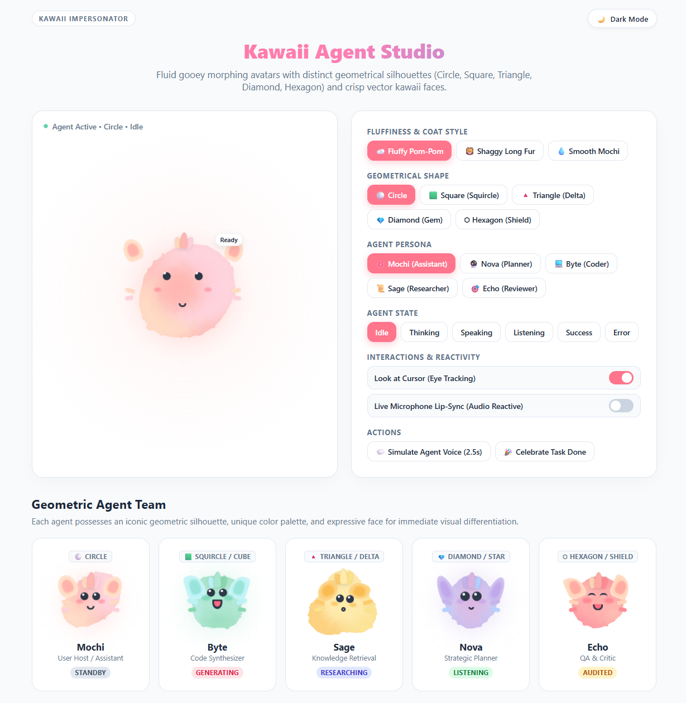

# 🌸 Kawaii Agent Avatars Studio for Agentic Architectures

<p align="left">
  
  
  
  
  
  
  
  
  
</p>

Fluid, morphing gooey pastel dots with **distinct geometrical silhouettes** (Circle, Square, Triangle, Diamond, Hexagon) and crisp vector kawaii faces, built natively for web applications to impersonate autonomous AI agents in real-time.



---

## 📐 5 Geometrical Agent Archetypes

Each agent in your orchestration system can possess its own iconic geometrical shape, color palette, and expressive face:

| Shape | Persona | Role | Colors | Geometry & Silhouette |
| :---: | :--- | :--- | :--- | :--- |
| **⚪ Circle** | **Mochi** | Assistant / Host | `#ffb7b2` (Rose), `#ffdac1` (Peach) | Classic round fluid droplet; warm, friendly, and approachable. |
| **🟩 Square** | **Byte** | Code Synthesizer | `#a8e6cf` (Mint), `#bbf2f6` (Aqua) | Squishy gelatin squircle / code block; springy corner jiggles. |
| **🔺 Triangle** | **Sage** | Knowledge Retrieval | `#ffeaa7` (Buttercup), `#fdcb6e` (Honey) | Bouncy rounded pyramid / delta; face sits naturally in the base. |
| **💎 Diamond** | **Nova** | Strategic Planner | `#d8b4e2` (Lavender), `#b5d0ff` (Periwinkle) | Radiant 4-point cosmic rhombus / star gem; sparkling tilt. |
| **⬡ Hexagon** | **Echo** | QA & Critic | `#ffaaa5` (Coral), `#ffd3b6` (Apricot) | Symmetrical 6-facet cyber shield; structured and analytical. |

---

## ☁️ Fluffy & Shaggy Coat Styling

Each agent can sport an expressive tactile coat texture configured via `fluff="fluffy | shaggy | smooth"`:

| Coat Style | Attribute | Visual Effect | Technique |
| :--- | :--- | :--- | :--- |
| **☁️ Fluffy Pom-Pom** | `fluff="fluffy"` *(Default)* | Soft plush cloud fur; tactile velvety edge fuzz | SVG Fractal noise displacement (`scale="14"`), velvet box-shadows, head tufts & ear fluffs |
| **🦁 Shaggy Fur** | `fluff="shaggy"` | Wild, longer hair tufts with spirited anime spikes | SVG Fractal turbulence displacement (`scale="22"`), expressive ear tufts |
| **💧 Smooth Mochi** | `fluff="smooth"` | Glossy, silky jelly slime droplet | Classic Gaussian blur + alpha threshold matrix filter |

### Cute Vector Fur Features:
- **Crown Head Tuft** (`.head-fluff`): 3-strand swaying anime hair sprout at the apex.
- **Persona-Tailored Ear Tufts** (`.ear-fluffs`): Round bear ears (Mochi), pointed cat ears (Byte), owl feather tufts (Sage), bunny ears (Nova), lynx ear tips (Echo).
- **Cheek Fur Whiskers** (`.cheek-fluff`): Cute side tufts framing the blushing cheeks.

---

## 💡 Architectural Core: Multi-Layer Separation

To achieve organic, liquid-like morphing between geometric blobs with procedural fluffy fur without melting or distorting the facial features (eyes, blush, mouth), the rendering is strictly decoupled:

```
┌────────────────────────────────────────────────────────┐
│  .kawaii-character[data-shape="triangle"][data-fluff="fluffy"]
│                                                        │
│  ┌──────────────────────────────────────────────────┐  │
│  │ Layer 3: Hair Tufts & Ears (Vector Accent Tufts) │  │
│  │   • .head-fluff (3-strand swaying crown tuft)    │  │
│  │   • .ear-fluffs (persona-specific ear shapes)    │  │
│  │   • .cheek-fluff (soft cheek fur whiskers)       │  │
│  └──────────────────────────────────────────────────┘  │
│                                                        │
│  ┌──────────────────────────────────────────────────┐  │
│  │ Layer 2: .kawaii-face (Z-Index: 10, Unfiltered)  │  │
│  │   • Crisp vector eyes with specular shine        │  │
│  │   • Soft glowing blush cheeks                    │  │
│  │   • Scalable mouth (procedural & audio lip-sync) │  │
│  └──────────────────────────────────────────────────┘  │
│                                                        │
│  ┌──────────────────────────────────────────────────┐  │
│  │ Layer 1: .goo-container (Filter: url(#fluffy-goo))│
│  │   • feTurbulence + feDisplacementMap fur edges   │  │
│  │   • Blob 1..4 (Shape vertices & velvety plush)   │  │
│  └──────────────────────────────────────────────────┘  │
└────────────────────────────────────────────────────────┘
```

---

## 🔄 Agentic States & Dynamic Expressions

Set `state="idle"`, `state="thinking"`, etc., to reflect your agent's real-time lifecycle:

- **`idle`**: Gentle breathing and periodic cute blinks.
- **`thinking`**: Rapid blob swirls, pondering upward glance, and inquisitive head tilt.
- **`speaking`**: Upbeat face bounce with animated lip-sync and glowing cheeks.
- **`listening`**: Blobs swell, eyes widen, and listening posture engages.
- **`success`**: Celebration bounce with joyful crescent eyes (`^ _ ^`).
- **`error`**: Distress wobble/shiver with wobbly mouth.

---

## 🚀 Embedding in Your Web Application

### Option 1: Web Component (Recommended)

Include the script and stylesheet, then use the `<kawaii-agent>` custom element:

```html
<link rel="stylesheet" href="kawaii-agent.css">
<script src="kawaii-agent.js" defer></script>

<!-- Specify persona, custom shape, coat texture, and state -->
<kawaii-agent 
  id="planner-agent"
  persona="nova" 
  shape="diamond"
  fluff="fluffy"
  state="thinking" 
  size="240px" 
  track-mouse="true"
  badge="Planning...">
</kawaii-agent>
```

#### JavaScript Control API:
```javascript
const agent = document.getElementById('planner-agent');

// Switch persona, shape, and coat texture
agent.persona = 'byte';
agent.shape = 'square'; // 'circle' | 'square' | 'triangle' | 'diamond' | 'hexagon'
agent.fluff = 'shaggy'; // 'fluffy' | 'shaggy' | 'smooth'

// Switch state
agent.state = 'speaking';
agent.badge = 'Generating code...';

// Real-time audio lip-sync from microphone
await agent.startMicReactivity();

// Or pass live stream volume factor (0.0 to 1.0)
agent.setAudioLevel(0.85);

// Simulate natural speech for 3 seconds
agent.say(3000, () => {
  agent.state = 'idle';
  agent.badge = 'Ready';
});
```

---

### Option 2: React / Next.js Component

```tsx
import React, { useEffect, useRef } from 'react';
import './kawaii-agent.css';
import './kawaii-agent.js';

interface KawaiiAgentProps {
  persona?: 'mochi' | 'nova' | 'byte' | 'sage' | 'echo';
  shape?: 'circle' | 'square' | 'triangle' | 'diamond' | 'hexagon';
  fluff?: 'fluffy' | 'shaggy' | 'smooth';
  state?: 'idle' | 'thinking' | 'speaking' | 'listening' | 'success' | 'error';
  size?: string;
  badge?: string;
  trackMouse?: boolean;
}

export const AgentAvatar: React.FC<KawaiiAgentProps> = ({
  persona = 'byte',
  shape = 'square',
  fluff = 'fluffy',
  state = 'idle',
  size = '220px',
  badge = '',
  trackMouse = true,
}) => {
  const agentRef = useRef<any>(null);

  useEffect(() => {
    if (agentRef.current) {
      agentRef.current.persona = persona;
      agentRef.current.shape = shape;
      agentRef.current.fluff = fluff;
      agentRef.current.state = state;
      agentRef.current.badge = badge;
    }
  }, [persona, shape, fluff, state, badge]);

  return (
    // @ts-ignore
    <kawaii-agent
      ref={agentRef}
      persona={persona}
      shape={shape}
      fluff={fluff}
      state={state}
      size={size}
      track-mouse={trackMouse ? 'true' : 'false'}
    />
  );
};
```

---

### Option 3: Pure HTML & CSS (No JavaScript Frameworks)

```html
<div class="kawaii-character" data-persona="sage" data-shape="triangle" data-fluff="fluffy" data-state="thinking">
  <!-- Fluffy Ears & Crown Tuft -->
  <div class="ear-fluffs">
    <div class="ear-fluff left-ear"></div>
    <div class="ear-fluff right-ear"></div>
  </div>
  <div class="head-fluff">
    <span class="fur-strand strand-1"></span>
    <span class="fur-strand strand-2"></span>
    <span class="fur-strand strand-3"></span>
  </div>

  <!-- Layer 1: Morphing Fluffy Gooey Background -->
  <div class="goo-container">
    <div class="blob blob-1"></div>
    <div class="blob blob-2"></div>
    <div class="blob blob-3"></div>
    <div class="blob blob-4"></div>
  </div>

  <!-- Cheek Fur Whiskers -->
  <div class="cheek-fluff cheek-fluff-left">
    <span class="whisker whisker-1"></span>
    <span class="whisker whisker-2"></span>
  </div>
  <div class="cheek-fluff cheek-fluff-right">
    <span class="whisker whisker-1"></span>
    <span class="whisker whisker-2"></span>
  </div>

  <!-- Layer 2: Unfiltered Kawaii Face -->
  <div class="kawaii-face">
    <div class="eyes">
      <div class="eye left"></div>
      <div class="eye right"></div>
    </div>
    <div class="blush">
      <div class="cheek left-cheek"></div>
      <div class="cheek right-cheek"></div>
    </div>
    <div class="mouth"></div>
  </div>
</div>

<!-- Global Filter Definition (place once in body) -->
<svg aria-hidden="true" style="position: absolute; width: 0; height: 0; pointer-events: none;">
  <defs>
    <filter id="fluffy-goo" x="-30%" y="-30%" width="160%" height="160%" color-interpolation-filters="sRGB">
      <feGaussianBlur in="SourceGraphic" stdDeviation="10" result="blur" />
      <feColorMatrix in="blur" mode="matrix" values="1 0 0 0 0  0 1 0 0 0  0 0 1 0 0  0 0 0 19 -9" result="goo" />
      <feTurbulence type="fractalNoise" baseFrequency="0.085 0.085" numOctaves="3" result="furNoise" seed="8" />
      <feDisplacementMap in="goo" in2="furNoise" scale="14" xChannelSelector="R" yChannelSelector="G" result="furEdge" />
      <feComposite in="furEdge" in2="goo" operator="over" />
    </filter>
  </defs>
</svg>
```

---

## 📂 File Directory

- `kawaii-agent.css`: Production stylesheet with gooey blend filter, 5 geometric shape systems, 5 persona palettes, and 6 agent states.
- `kawaii-agent.js`: Encapsulated Web Component with cursor tracking, Web Audio API microphone lip-sync, and shape switching.
- `index.html`: Interactive studio to test geometric shapes, personas, states, and voice reactivity.
- `README.md`: Complete architecture and integration documentation.
